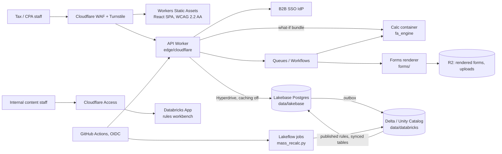

# Architecture decisions

Condensed from `research/08-platform-architecture.md` (full reasoning, alternatives, costs, sources).
Items marked VERIFY there are still VERIFY here.

## Decisions

| # | Decision | Why | Where |
|---|---|---|---|
| 1 | **Lakebase (Databricks-managed Postgres) is the system of record for interactive edits.** Delta holds published calc runs, history, reporting, audit. | SQL warehouses are too slow and lack transactional constraints for per-keystroke CRUD; Lakebase stays inside Databricks governance and is plain Postgres (exit path). | `data/lakebase/001_core.sql` |
| 2 | **Pooled multi-tenancy:** `tenant_id` on every table, Postgres RLS + Unity Catalog row filters; dedicated "silo" tier (own Lakebase project, catalog, key) for enterprise. | Catalog-per-tenant hits UC catalog quotas around 500 tenants and multiplies every pipeline. | RLS: `001_core.sql`; row filter: `002_tenant_catalog.sql` |
| 3 | **Defense in depth on isolation:** RLS *and* an explicit `tenant_id` predicate in every query; Hyperdrive query caching off. | Cached results + session-variable RLS can serve one tenant's rows to another. | `edge/cloudflare/src/index.ts` |
| 4 | **Bitemporal everything:** valid time (date the law/fact applies) + knowledge time (`recorded_at`/`superseded_at`). Corrections insert; they never update. | Reproduce an as-filed return exactly; run "what would it be under today's rules"; detect amendments when states change law retroactively (FL, NY, PA did in 2025–26). | `asset_book_version` exclusion constraint; every rule table |
| 5 | **Rules are data; logic is versioned code.** Parameters, conformity decision tables, factor tables, form maps live in `<env>_rules`; MACRS switch logic, MQ test, recapture live in `fa_engine`. No Turing-complete rules DSL. | Tax SMEs can review rows with citations; they cannot safely review a second programming language. | `001_rules_catalog.sql`, `engine/` |
| 6 | **Published IRS tables are loaded, not generated.** The generator is tested against them. | The 39-year table (A-7a) was not built by formula: Jan 2.461% published vs 2.457% computed. | `ruledata/federal/macrs_tables.csv` |
| 7 | **One calc code path.** The same `fa_engine` wheel runs in Spark (`applyInPandas`) and in the calc container; CI asserts identical output. Calcs are two-phase: entity-year (MQ test, §179 limit) then asset-book. | Batch and what-if must never disagree; one new Q4 asset can legitimately change every other asset's convention. | `data/databricks/jobs/mass_recalc.py` |
| 8 | **The calc container has no database credentials.** It receives the full input bundle and returns results. | Smaller blast radius; deterministic, replayable runs. | `src/index.ts` `/v1/whatif` |
| 9 | **Forms are filled by semantic key**, never by computing in the form layer. Official PDF fill first; Pub 1167 substitutes only where needed. | Line renumbering (e.g. 4562 lines 19h/20e in 2025) becomes a data change. | `forms/` |
| 10 | **Filing path:** official PDFs + workpapers → push data/XML into customers' return software (CCH, Thomson Reuters, Corptax, Intuit) → own IRS MeF transmitter status only if we build full returns. | 4562/4797 etc. are attachments; MeF accepts them only inside a complete return from ATS-tested software. | `research/04` |
| 11 | **Rule releases are four-eyes, regression-gated, and pinned per book.** Closed periods never change silently. | This is the SOC 1 change-management control customers' auditors will test. | `docs/swarm-playbook.md`, `releases.rule_release` |
| 12 | **Accessibility is a requirement, not a polish item:** WCAG 2.2 AA app, Section 508/VPAT for government buyers, PDF/UA-tagged output. | Tax reviewers include people using screen readers and keyboard-only navigation; government and enterprise buyers require an ACR. | `research/08 §8.4` |

## Data model in one page

- **Shared asset master** (`asset`): facts true in every book — dates (acquired, binding contract,
  construction began, placed in service), cost, class, location, property type.
- **Per-book treatment** (`asset_book_version`): method, life, convention, basis, §179, bonus,
  elections — bitemporal, one current version per (asset, book, valid period).
- **Books** (`book_def`): FED_TAX, AMT, ACE, EP, GAAP, IFRS, STATE (one per state), LOCAL_PP, MGMT,
  SCENARIO; a state book is *derived* from federal plus conformity rules and materialized only where
  basis differs (`research/06 §8.3`).
- **Entity-year aggregates** (`entity_year_aggregate`): inputs to taxpayer-level rules (MQ test, §179).
- **Events** (`asset_txn`): additions through dispositions, impairments, revaluations, estimate changes;
  back-dated events post catch-up to the open period (`research/05 §7.4`).
- **Jurisdictions** (`reference.jurisdiction`, `location_jurisdiction`): state → assessing jurisdiction →
  taxing unit → tax rate area, with situs over time (`research/07`).
- **Runs** (`gold.calc_run`): every output row carries `run_id`, `rules_release_id`, `engine_version`,
  `inputs_hash`.

## Open risks (from research/08, 05, 04)

1. Lakebase maturity: CDC feed in preview (outbox until GA), private path from Cloudflare unconfirmed,
   connection pooling forces password roles. Fallback: AWS Fargate behind Cloudflare Tunnel.
2. SOC 1 Type II needs 12–15 months of evidence; auditors may expect assurance over rule *content*,
   not just change control. Start evidence collection in phase 0.
3. Delta time travel is not audit retention — closed-period snapshots and hash-chained audit with
   Object Lock anchors are required.
4. §7216 limits ML/analytics on customer return data without consent; FTC Safeguards Rule applies.
