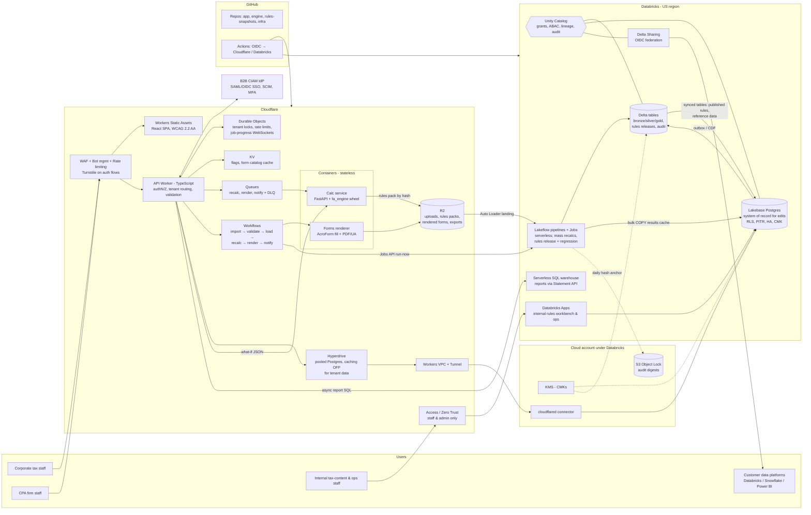

# 08 — Platform Architecture and the Hard Engineering Choices

*Research swarm, fixed-asset SaaS. Written 2026-10-30. Scope: reference architecture on Cloudflare + Databricks + GitHub for a multi-tenant fixed-asset / tax and GAAP depreciation / compliance-forms platform.*

**Confidence legend.** **[H]** high: confirmed in official docs or changelogs found during this research. **[M]** medium: official source seen only as a search snippet, or a consistent secondary source. **[L]** low: inferred, or from memory (knowledge cutoff June 2026). **VERIFY** means check this before relying on it.

**Method note.** Direct page fetches of developers.cloudflare.com, docs.databricks.com and infoq.com were blocked by this session's network allow-list, and the swarm's shared web-search budget ran out partway through. Vendor facts below come from search-result extracts of official pages, which are cited. Anything not confirmed that way is marked.

---

## 1. Executive summary

- **Split the system into four planes.** (1) An **edge plane on Cloudflare**: Workers Static Assets for the SPA, a TypeScript API Worker, WAF, Turnstile, Access, Durable Objects, Queues, Workflows, R2 and Hyperdrive. (2) A **stateless compute plane on Cloudflare Containers** for the Python calc engine and PDF rendering. (3) An **operational data plane on Databricks Lakebase (Postgres)**. (4) An **analytical and governance plane on Databricks**: Unity Catalog, Delta, Lakeflow pipelines and Jobs, serverless SQL, Delta Sharing, and Apps for internal consoles. GitHub holds code, rules snapshots and CI/CD. CI deploys with OIDC and stores no secrets.
- **OLTP decision: Lakebase Postgres is the system of record for interactive edits. Delta is the system of record for published computations, history, reporting and audit evidence.** Delta through a SQL warehouse has the wrong latency, concurrency and constraint model for per-keystroke CRUD. Lakebase keeps the OLTP store inside the Databricks governance boundary, which is the founder's requirement. It reached GA on AWS on 2026-02-03 **[M]**, and it is standard Postgres, so there is an exit path.
- **Rules are data:** effective-dated, bitemporal and released as immutable, content-hashed **rules packs**. A four-eyes approval workflow gates each release, and every release must pass a regression pack plus a cross-tenant impact diff before it is published.
- **One calc code path:** a pure-Python, Decimal-only, side-effect-free `fa_engine` wheel. The same wheel runs in PySpark (`applyInPandas`) for mass recalcs and in a stateless FastAPI container for single-asset what-ifs. CI runs parity tests on both adapters.
- **Multi-tenancy uses a pool model by default:** shared tables keyed by `tenant_id`, Postgres RLS, and Unity Catalog ABAC row filters for human and BI access. A **silo tier** (dedicated Lakebase project, CMK and catalog) is available for enterprise and regulated tenants. Catalog-per-tenant was rejected as the default.
- **Compliance drives the roadmap.** Customers' auditors will rely on the calculations, so **SOC 1 Type II** (ICFR) matters as much as SOC 2 Type II. Start evidence collection on day 1. Design for the FTC Safeguards Rule and IRS Pub 4557 / 5708 obligations of CPA-firm customers. Treat WCAG 2.2 AA and PDF/UA output as product requirements.
- **Rough infra cost:** about **$2.5k–$5k per month at 10 tenants** and **$15k–$35k per month at 500 tenants**. Audits, CIAM and compliance tooling are extra, and they dominate at MVP.

---

## 2. Recommended architecture

**Request paths in one paragraph.** A user edits an asset in the SPA. The API Worker validates the session JWT, resolves the tenant, and opens a transaction through Hyperdrive to Lakebase. It sets `app.tenant_id` with `set_config(..., true)` and writes the new asset version, an audit event and an outbox row atomically. It then calls the calc container synchronously with the full input bundle (asset, books, entity-year aggregates and rules-pack hash) and stores the current-period result in the serving cache. Entity-wide side effects such as mid-quarter convention flips are enqueued as a recalc job. The outbox drains to Delta every few minutes. Nightly and on-demand mass recalcs run as Databricks serverless jobs over Delta and bulk-load summary results back into Lakebase. Forms are rendered in containers and stored in R2. Reports that scan large history go to the SQL warehouse asynchronously.

---

## 3. Component decisions, with alternatives

### 3.1 Cloudflare: what goes at the edge

| Component | Decision | Status / facts (2026) | Alternatives considered |
|---|---|---|---|
| **Workers (TypeScript)** | API gateway and BFF for CRUD orchestration. Hono, Zod and Kysely over Hyperdrive. | Paid plan $5/mo; 10M requests included then $0.30/M; 30M CPU-ms included then $0.02/M CPU-ms **[H]** ([pricing](https://developers.cloudflare.com/workers/platform/pricing/)) | Python Workers for the whole API (see below). A traditional backend in AWS behind Tunnel. |
| **Python Workers** | **Pilot, not core, in 2026.** Possible future host for `fa_engine` what-ifs, which would remove container cold starts. | **GA announced 2026-09-21** **[M]** ([blog](https://blog.cloudflare.com/python-workers-ga/), [Willison](https://simonwillison.net/2026/Sep/21/cloudflare-python-worker/)). Runs on Pyodide (CPython compiled to WebAssembly). Supports pure-Python and PyEmscripten wheels. FastAPI, Django and Flask run via `workers.asgi` / `workers.wsgi`. asyncpg works via Hyperdrive. **No threading or multiprocessing** ([packages docs](https://developers.cloudflare.com/workers/languages/python/packages/)) **[M]** | Making it core now. Rejected: GA is about 5 weeks old, and Decimal-heavy engine parity with CPython would need proving first. |
| **Pages** | **Do not use.** Ship the SPA as **Workers Static Assets**. | Cloudflare says Pages is not being sunset, but all new investment goes to Workers, and it recommends that new projects start on Workers **[M]** ([migrate guide](https://developers.cloudflare.com/workers/static-assets/migrate-from-pages/)) | Pages. It still works, but it is in maintenance mode. |
| **Containers** | Stateless **calc service** and **PDF renderer** (native libraries, full CPython). | **GA 2026-04-13** **[H]** ([changelog](https://developers.cloudflare.com/changelog/post/2026-04-13-containers-sandbox-ga/)). Up to 4 vCPU / 12 GiB / 20 GB disk per instance via custom types **[M]** ([limits](https://developers.cloudflare.com/containers/platform-details/limits/)). Account concurrency rose to 6 TiB of memory **[H]** ([changelog](https://developers.cloudflare.com/changelog/post/2026-02-25-higher-container-resource-limits/)). CPU billed on active use only since Nov 2025 **[H]** ([changelog](https://developers.cloudflare.com/changelog/post/2025-11-21-new-cpu-pricing/)). Memory $0.0000025/GiB-s, CPU $0.00002/vCPU-s, disk $0.00000007/GB-s **[M]** ([pricing](https://developers.cloudflare.com/containers/pricing/)). Cold-start improvement to about 650 ms median: **VERIFY** | AWS ECS Fargate in the Databricks region behind Cloudflare Tunnel. This is the **fallback** if container placement cannot be pinned to the US (open question). Databricks Model Serving: rejected for scale-to-zero cold starts and a cost model built for ML **[L]**. |
| **Queues** | Buffer recalc, render and notification work, with DLQs. | $0.40 per million operations **[M]** | Durable Object alarms only. |
| **Workflows** | Durable orchestration of multi-step, user-visible operations (imports, period close, filing packages). Steps call the Databricks Jobs API and wait for completion events. | 10,000 steps per instance by default, configurable to 25,000 (Mar 2026). Step output cap 1 MiB. Billed at Workers CPU and request rates plus storage **[H]** ([limits](https://developers.cloudflare.com/workflows/reference/limits/), [changelog](https://developers.cloudflare.com/changelog/post/2026-03-03-step-limits-to-25k/)) | Databricks Jobs only. Rejected for app-level UX steps such as user notifications and human approvals. Jobs remain the data-level orchestrator. |
| **R2** | Landing zone for uploads (presigned PUT), immutable rules packs, rendered forms, and exports. Object keys prefixed `tenant/<id>/`. | $0.015/GB-month; Class A $4.50/M; Class B $0.36/M; zero egress **[H]** ([pricing](https://developers.cloudflare.com/r2/pricing/)). Unity Catalog external location support for R2: **VERIFY**. R2 jurisdictional buckets and bucket locks: **VERIFY** | S3 in the Databricks account. Still used for Object Lock audit anchors. |
| **D1** | **Not used** for tenant data. | 10 GB per database, 50k databases per account, 1 TB per account (Paid) **[H]** ([limits](https://developers.cloudflare.com/d1/platform/limits/)) | D1 per tenant. Rejected: SQLite has no RLS, the data would sit outside Databricks governance, and it would create a second OLTP store. |
| **Hyperdrive** | Connection pooling from Workers to Lakebase. **Disable query caching on the tenant-data config** (see §8). | Workers VPC is now the recommended private path. Worker → Hyperdrive → VPC Service → Tunnel → database, with no Access service tokens needed (2026-04-29) **[H]** ([docs](https://developers.cloudflare.com/hyperdrive/configuration/connect-to-private-database-vpc/), [changelog](https://developers.cloudflare.com/changelog/post/2026-04-29-hyperdrive-vpc-private-databases/)). Custom CA upload not yet supported **[M]** | A direct TLS connection to the public Lakebase endpoint. Acceptable for MVP if IP allow-listing exists (VERIFY). |
| **KV** | Feature flags, form-catalog and reference-data caches, signing-key sets. **Never for authorization state.** KV is eventually consistent (about 60 s, **[L]**). | Included in the Paid plan | — |
| **Durable Objects** | Per-tenant coordinator: a period-close mutex versus mass recalc, idempotency keys, per-tenant rate limits, and a WebSocket hub for job progress. Use the SQLite backend. | 1M requests included then $0.15/M. SQLite backend recommended for new classes **[H]** ([pricing](https://developers.cloudflare.com/durable-objects/platform/pricing/)). EU and FedRAMP jurisdictions: **VERIFY** | Postgres advisory locks. Kept as a secondary guard. |
| **Access / Zero Trust** | Internal staff consoles, Databricks workspace access, admin APIs, and break-glass. **Not for customer end users.** | Free under 50 users; pay-as-you-go $7 per user per month **[M]** ([plans](https://www.cloudflare.com/plans/sase-zero-trust/)) | Using Access for customers. Rejected on per-seat cost and B2B SSO and SCIM requirements; use a CIAM such as WorkOS, Auth0 or Okta CIC instead (vendor choice open). |
| **WAF / Turnstile / Bot mgmt** | Managed rulesets, per-tenant and per-route rate limits, and Turnstile on login, signup, password reset and invite flows. | Business plan is $200 or $250 per month per zone; sources conflict, **VERIFY** ([plans](https://www.cloudflare.com/plans/)) | — |
| **Cloudflare for SaaS** | Custom hostnames for CPA-firm white-labelling (phase 2). | 100 hostnames included, then $0.10 each **[H]** ([plans](https://developers.cloudflare.com/cloudflare-for-platforms/cloudflare-for-saas/plans/)) | Subdomains only. |
| **Data Localization Suite** | Regional Services (US) plus Customer Metadata Boundary (US) once on Enterprise. | CMB regions are US and EU only. EU CMB blanks most dashboard analytics **[M]** ([DLS](https://developers.cloudflare.com/data-localization/)) | — |

**Edge versus backend, the rule of thumb.** The edge handles anything that is stateless, per-request, latency-sensitive or security-perimeter work: TLS, WAF, bot defence, authentication, tenant resolution, input validation, presigned URLs, static assets, fan-out and orchestration. Containers handle CPU-bound but stateless work (calc, render), and they receive their inputs in the request. They hold **no database credentials**, which limits the blast radius. Databricks handles anything stateful, large or governed: the OLTP store, all history, mass compute, rules releases, reporting and sharing.

### 3.2 Databricks components

| Component | Decision | Status / facts |
|---|---|---|
| **Lakebase (Autoscaling)** | OLTP system of record (§3.3). One prod project for pool-tier tenants. Silo-tier tenants get their own project. **Enable CMK at creation**, because CMK applies only to new projects. | GA (AWS 2026-02-03; Azure March 2026; GCP still Beta) **[M]** ([announcement](https://community.databricks.com/t5/announcements/databricks-lakebase-is-now-generally-available/td-p/147678)). $0.111 per CU-hour **[H]** ([pricing](https://docs.databricks.com/aws/en/oltp/projects/pricing)). Always-On pricing gives 25% off baseline capacity (2026-05-27) **[M]**. Up to 64 CU / 128 GB (2026-05-20) **[M]** ([May notes](https://docs.databricks.com/aws/en/release-notes/product/2026/may)). HA with 1 primary and 1–3 secondaries across AZs, and HA requires scale-to-zero off **[H]** ([HA](https://docs.databricks.com/aws/en/oltp/projects/high-availability)). PITR window 2–30 days, restored as a branch **[H]** ([PITR](https://docs.databricks.com/aws/en/oltp/projects/point-in-time-restore)). CMK in all AWS and Azure Lakebase regions **[M]** ([CMK](https://community.databricks.com/t5/announcements/take-control-customer-managed-keys-for-lakebase-postgres/td-p/155338)). Supported under the compliance security profile with HIPAA, C5, TISAX or no standard **[M]** ([release notes](https://docs.databricks.com/aws/en/release-notes/lakebase/)). |
| **Lakebase auth** | Hyperdrive uses a **native Postgres password role**, rotated by our own job. Databricks-side consumers use OAuth. | OAuth database credentials last 60 minutes. The built-in PgBouncer pooler **does not support OAuth**. Native passwords do not expire **[H]** ([auth](https://docs.databricks.com/aws/en/oltp/projects/authentication), [external apps](https://docs.databricks.com/aws/en/oltp/projects/external-apps-manual-api)). |
| **Delta → Postgres** | **Synced tables** for *published* rules, reference data and form catalogs (small; Snapshot or Triggered mode on release). | Synced tables are read-only on the Postgres side, and Databricks recommends read-only queries. Triggered and Continuous modes need CDF on the source. Continuous mode is the most expensive **[H]** ([synced tables](https://docs.databricks.com/aws/en/oltp/projects/sync-tables), [cost guide](https://www.databricks.com/blog/practical-guide-cost-optimization-lakebase-postgres)). One illustrative figure: a 181M-row table costs about $1.4k–$2.1k/month to sync **[M]**. **Do not sync large result tables.** |
| **Postgres → Delta** | **Transactional outbox, pulled incrementally** via the UC-registered Lakebase catalog (federated read). Adopt **Lakebase Change Data Feed** when it is GA. | Lakebase CDF is **Public Preview** **[M]** ([quickstart](https://learn.microsoft.com/en-us/azure/databricks/oltp/projects/quickstart-lakebase-cdf)). Lakeflow Connect for Postgres was described as private preview in a community answer **[L]**. |
| **Lakebase Data API** | Not used. All access goes through our API Worker. | PostgREST-compatible, Public Preview, OAuth-only **[M]** ([Data API](https://docs.databricks.com/aws/en/oltp/projects/data-api)). |
| **Unity Catalog** | Single US metastore. Catalogs per environment × domain (§4). ABAC row filters and column masks for human and BI access. | ABAC row and column policies announced GA. Some pages still say Beta, so **VERIFY** per cloud ([blog](https://www.databricks.com/blog/abac-row-filtering-and-column-masking-policies-governed-tags-and-data-classification-are-now), [policies](https://docs.databricks.com/aws/data-governance/unity-catalog/abac/policies)). Row filters cannot be applied to views **[M]**. Soft quotas: about 1,000 catalogs per metastore and 10,000 schemas per catalog **[M]** ([quotas](https://docs.databricks.com/aws/en/resources/manage-resource-quotas)). |
| **Delta Lake** | MERGE for batch upserts (imports, derived tables). Liquid clustering on `(tenant_id, …)`. CDF on silver. `delta.appendOnly` on audit tables. | Deletion vectors are soft deletes; physical removal needs `REORG TABLE … APPLY (PURGE)` and then `VACUUM` **[H]** ([vacuum](https://learn.microsoft.com/en-in/azure/databricks/delta/vacuum)). The default `deletedFileRetentionDuration` of 7 days and `logRetentionDuration` of 30 days come from community sources **[M]**. **Time travel is not an audit or bitemporal mechanism** (§5). |
| **Lakeflow Spark Declarative Pipelines (ex-DLT) and Lakeflow Jobs** | Pipelines for bronze→silver ingestion (Auto Loader on R2/S3, outbox) with expectations. Jobs for mass recalcs, rules releases and regression packs, and form batch prep. Serverless. | The DLT engine was renamed and contributed to Apache Spark 4.1 as `pyspark.pipelines`. AUTO CDC and expectations remain Databricks-only **[M]** ([python ref](https://docs.databricks.com/aws/en/dlt/python-ref)). |
| **Serverless SQL warehouse + Statement Execution API** | Asynchronous **reports** only: rollforwards, multi-year history and audit queries. **Never on the edit path.** | `wait_timeout` 5–50 s (default 10 s) or 0 for async. Inline results capped at 25 MiB; use `EXTERNAL_LINKS` beyond that **[M]** ([API](https://docs.databricks.com/api/workspace/statementexecution), [SDK](https://databricks-sdk-py.readthedocs.io/en/stable/workspace/sql/statement_execution.html)). 2X-Small is 4 DBU/h, about $2.80/h at $0.70/DBU (third-party, **VERIFY**). No published cold-start SLA. Databricks advises measuring cold and warm latency separately ([sizing](https://docs.databricks.com/compute/sql-warehouse/warehouse-behavior.html)). |
| **Databricks Apps** | **Internal only:** a rules workbench for tax-content SMEs and an ops console. | Apps are accessible only to authenticated users of the Databricks account, with no anonymous or external access **[M]** ([networking](https://docs.databricks.com/aws/en/dev-tools/databricks-apps/networking)). Compute sizes: 0.5 DBU/h (2 vCPU / 6 GB) and 1 DBU/h (4 vCPU / 12 GB); sizing GA January 2026 **[M]** ([compute size](https://docs.databricks.com/en/dev-tools/databricks-apps/compute-size.html)). |
| **Delta Sharing** | Outbound: per-tenant shares of the gold layer to customers' platforms. Inbound: receive ERP subledger shares. Use **OIDC federation, not bearer tokens.** | OIDC federation supports U2M and M2M. **Open-sharing bearer tokens issued before 2025-12-08 auto-expire on 2026-12-08** **[M]** ([OIDC](https://docs.databricks.com/gcp/delta-sharing/create-recipient-oidc-fed), [tokens](https://docs.databricks.com/aws/en/delta-sharing/create-recipient-token)). Per-recipient partition filtering via recipient properties: **VERIFY**. |
| **Bundles** | All jobs, pipelines, apps, synced tables and grants are declared as bundles and deployed from GitHub Actions. | **Renamed "Declarative Automation Bundles" on 2026-03-16.** The change is non-breaking: the `databricks bundle` CLI and existing configs are unchanged, and "DAB" still applies **[H]** ([release notes](https://docs.databricks.com/aws/en/release-notes/dev-tools/bundles), [FAQ](https://docs.databricks.com/aws/en/dev-tools/bundles/faqs)). |
| **CI auth** | GitHub OIDC **workload identity federation** to Databricks service principals. No client secrets; `DATABRICKS_AUTH_TYPE=github-oidc`. | The federation policy subject must match exactly. For Apps, `bundle deploy` does not restart the app, so `bundle run` is also needed **[H]** ([GitHub Actions](https://docs.databricks.com/aws/en/dev-tools/ci-cd/github), [bundle auth](https://docs.databricks.com/aws/dev-tools/bundles/authentication)). |
| **Workspace security** | Enterprise tier with the **compliance security profile** on prod workspaces. Serverless egress controls, PrivateLink and IP access lists. | CSP coverage varies by cloud, region and serverless feature **[M]** ([CSP](https://docs.databricks.com/aws/en/security/privacy/security-profile)). Whether CSP requires the Enterprise tier: **VERIFY**. |

### 3.3 The OLTP decision: Lakebase versus Delta directly

**Decision: Lakebase (Postgres) is the system of record for all interactive inputs and workflow state. Delta is the system of record for published calc runs, history, reporting and audit evidence.**

| Criterion | Delta via SQL warehouse | Lakebase Postgres |
|---|---|---|
| Point read/write latency | Hundreds of ms to seconds per statement. Warehouse cold starts. Async polling. | Single-digit ms (pooled). |
| Concurrency on hot rows | Optimistic, commit-level. Row-level concurrency with deletion vectors reduces but does not remove MERGE conflicts **[L]** | Row locks, MVCC, `SELECT … FOR UPDATE`. |
| Constraints | NOT NULL and CHECK only. PK/FK informational **[L]** | PK, FK, UNIQUE, EXCLUDE (non-overlapping effective periods). |
| Multi-table transactions | Limited or preview (**VERIFY**) | Full ACID. |
| Tenant isolation | UC row filters (adds plan overhead) | RLS policies. |
| Governance fit | Native | Registered in UC. Synced tables and CDF bridge to Delta. |
| Cost at idle | Warehouse minimum while running | CU-hours. HA needs always-on compute. |

Lakebase was chosen over external Postgres (RDS, Neon, Supabase) because it keeps everything inside Databricks governance, and it adds branching for preview environments and PITR as a branch. **Exit path:** Lakebase is wire-compatible Postgres, so `pg_dump` works and RDS or Neon are drop-in fallbacks. Keep extension use to core plus `btree_gist` and `pgcrypto` until extension support is verified (**VERIFY** the supported PG major versions and extension list).

**How results and rules flow:**

1. **Inputs** (assets, books, transactions, elections, locations): written in Lakebase → outbox → Delta `silver` (bitemporal history).
2. **Single-asset calc on save:** the Worker gathers inputs and the entity-year aggregates and calls the calc container. Results go into the Lakebase `calc_result_current` serving cache and also to the outbox, then into a Delta `gold.calc_run` and `gold.depr_schedule` with `run_type='online'`.
3. **Mass recalcs:** a Databricks job reads silver at an explicit snapshot (`input_snapshot_id`) and writes `gold` (full-life schedules, rollforwards, form line values). A final step bulk-`COPY`s current, prior and next-year **summaries** into the Lakebase serving cache, in a single transaction per tenant and guarded by the tenant's Durable Object lock.
4. **Rules:** drafts are authored in Lakebase via the internal Databricks App. On approval, the release job writes an immutable Delta release and compiles a **rules pack** (JSON/MsgPack, SHA-256 named) to R2 and a UC Volume. Synced tables expose published releases read-only back to Lakebase. A JSON snapshot is committed to the `rules-snapshots` GitHub repo for diffing and DR.

---

## 4. Data model sketch

### 4.1 Unity Catalog layout (single US metastore)

| Catalog | Schemas | Key tables (all tenant tables carry `tenant_id`, liquid-clustered first) |
|---|---|---|
| `prod_rules` | `drafts_mirror`, `releases`, `reference`, `tests` | `releases.rule_release(release_id, content_hash, status, approved_by[], published_at)`, `releases.rule_item(release_id, rule_set, jurisdiction_id, key json, value json, valid_from, valid_to, applies_on: {acquired, placed_in_service, tax_year_begin})`, `reference.macrs_table`, `reference.class_life` (Rev. Proc. 87-56), `reference.jurisdiction` (FIPS/GNIS, parent chain), `reference.conformity_matrix(state, tax_year, irc_ref_date, bonus_conform, s179_limit_override, addback_years)`, `reference.property_tax_trend_table`, `reference.form_catalog(form_id, jurisdiction_id, tax_year, revision, template_uri, field_map)`, `tests.golden_case`, `tests.expected_result` |
| `prod_tenant` | `bronze`, `silver`, `gold`, `audit` | `bronze.import_file`, `bronze.outbox_event`; `silver.asset_version` and `silver.asset_book_version` (bitemporal: `valid_from/valid_to`, `recorded_at/superseded_at`), `silver.asset_txn`, `silver.location`, `silver.entity`, `silver.book_def`; `gold.calc_run(run_id, tenant_id, rules_release_id, engine_version, input_snapshot_id, run_type, started/finished, inputs_hash)`, `gold.depr_schedule(run_id, asset_id, book_id, period, depr, accum, nbv, method_applied, switch_flag)`, `gold.rollforward`, `gold.form_line_value(run_id, form_id, line_ref, jurisdiction_id, value)`, `gold.property_tax_return`; `audit.event` (append-only, hash-chained) |
| `prod_exchange` | `t_<tenant_short_id>` (silo or sharing tenants) | Views over gold for Delta Sharing and customer extracts |
| `prod_ops` | `metering`, `dq`, `jobs` | Per-tenant usage (billing), expectation results, run metadata |
| `prod_lakebase` | (foreign catalog) | Lakebase Postgres registered in UC for federated incremental reads |
| `stg_*`, `dev_*` | mirror | Synthetic or masked data only. Never copies of prod tenant data. |

Silo-tier tenants get `silo_<tenant>_tenant` catalogs bound to a dedicated storage location with its own KMS key, and optionally a dedicated workspace via workspace-catalog binding.

**Why not catalog-per-tenant by default.** It is clean on isolation, but at 500 tenants it uses about half the ~1,000-catalog soft quota. It also multiplies jobs, pipelines, grants and synced tables by N, and it makes cross-tenant release impact analysis and fleet-wide recalcs N separate operations. Row filters on shared tables cost some planning overhead. They are applied for **human and BI principals**, while the batch service principal is trusted and audited, and the application layer enforces `tenant_id` predicates.

### 4.2 Lakebase (Postgres) core schema

- `tenant`, `app_user`, `membership(role)`, `entity` (legal entity or CPA client; EIN encrypted with a per-tenant DEK), `book_def` (Federal, AMT, ACE, E&P, GAAP/IFRS, State XX, Local PP).
- `asset(tenant_id, asset_id, entity_id, number, description, class_code, location_id, acquired_on, placed_in_service_on, cost, …)`.
- `asset_book_version(tenant_id, asset_id, book_id, valid_period tstzrange, recorded_at, superseded_at, method, life, convention, basis, s179, bonus_pct, election_flags jsonb)` with `EXCLUDE USING gist (tenant_id WITH =, asset_id WITH =, book_id WITH =, valid_period WITH &&) WHERE (superseded_at IS NULL)`.
- `asset_txn` (addition, adjustment, transfer, partial or full disposition, impairment, like-kind), `location → jurisdiction_id`.
- `entity_year_aggregate` (mid-quarter test inputs, §179 totals and phase-out, luxury-auto counts).
- `period(status: open|closing|closed|locked)`, `calc_result_current`, `job`, `approval`.
- `audit_event` (INSERT-only grant), `outbox(seq bigserial, …)`, `rules_draft_*`, and `rules_published_*` (synced, read-only).
- RLS: `USING (tenant_id = current_setting('app.tenant_id')::uuid)` on every tenant table. The app role is `NOBYPASSRLS`, and the owner and migration roles are separate.

---

## 5. Rules-as-data design

**Two time axes on every rule and every input.**
- **Valid time** answers "when does this apply in the world?" It is keyed by the date the law actually uses: acquisition date, placed-in-service date, tax year beginning or ending, or a property-tax lien date. A single rule can depend on several dates.
- **Transaction time** answers "when did *we* know or publish it?" This is the release `published_at`, and for inputs it is `recorded_at` / `superseded_at`.

That lets the system answer the auditor's two questions. *"Reproduce exactly what you computed for the 2025 return filed on 2026-04-15"* is answered with the rules as known on that date, the inputs as recorded on that date, and the engine version pinned in the run. *"What would it be under today's corrected rules?"* is answered by re-running with the latest release.

**Why recent law makes this mandatory (examples to validate with the tax-content research doc).** The 2025 reconciliation act (OBBBA) restored 100% bonus depreciation for property *acquired* after 2025-01-19. It also raised §179 limits, and it allowed transition elections for the first tax year ending after that date **[L, VERIFY with tax content]**. The rule therefore depends on acquisition date, placed-in-service date and a taxpayer election, not just the tax year. On the property-tax side, Texas Proposition 9 (Nov 2025) raised the business personal property exemption to $125,000 for tax years from 2026 **[M]** ([Dallas CAD 2026 notice](https://www.dallascad.org/Admin/DMN_BPP_Rend_2026.pdf)). A jurisdiction threshold rule therefore changes by year.

**Representation.**
- **Parameters as tables:** rates, percentages, limits, phase-outs, class lives, convention tables, trending and depreciation factors, filing thresholds.
- **Conformity as decision tables** (DMN-style rows): `state × tax_year × entity_type → {irc_conformity_date, bonus: conform|decouple, addback_schedule, s179_override}`.
- **Logic stays in versioned engine code:** declining-balance to straight-line switch, mid-quarter test, short tax years, ADS, AMT and ACE adjustments, §168(k) elections, §1245/1250 recapture. Rules select *which* engine method and parameters apply. **No Turing-complete rules DSL.** It becomes an unversionable second programming language that tax SMEs cannot safely review.
- **Jurisdiction translation and mapping:** `jurisdiction` (FIPS, county and assessor district, parent chain) plus `location_jurisdiction_map(valid_period)`. Form line mapping lives in `form_catalog.field_map` (`line_ref → engine output key`) per form revision.

**Release workflow (four eyes, immutable output).**

```mermaid
stateDiagram-v2
  [*] --> Draft: SME edits in rules workbench (Databricks App → Lakebase)
  Draft --> Submitted: change set + citation (IRC §, Rev Proc, state bulletin URL)
  Submitted --> Draft: reviewer rejects
  Submitted --> Testing: reviewer ≠ author approves
  Testing --> Draft: regression or diff failure
  Testing --> ReadyToPublish: golden pack green + impact report signed off
  ReadyToPublish --> Published: release job writes Delta release, rules pack → R2/UC Volume, git snapshot
  Published --> Superseded: newer release for same scope
  Published --> Withdrawn: defect (never deleted; runs keep pointer)
```

**Regression test packs** (run as Databricks jobs and as unit tests in GitHub Actions):
1. **Golden cases.** IRS Pub 946 worked examples, Rev. Proc. 87-57 table reproductions, state examples, and customer-contributed anonymised cases, each with expected schedules.
2. **Invariants (property-based).** Accumulated depreciation never exceeds depreciable basis. Over the full life, the sum equals basis minus salvage. Book NBV is never negative. Disposals zero out NBV. Rounding stays within tolerance per book.
3. **Differential impact analysis.** Run the candidate release against a shadow copy of *all* tenants' current inputs and diff against the current release. Publish the per-tenant impact report, which doubles as customer release notes and SOC 1 change-management evidence. Material unexpected deltas block publication.
4. **Tax-year lock.** Filed periods pin `rules_release_id`. A new release never silently changes a locked period. Re-opening needs an approval, and the action is audited.

---

## 6. Calc engine design

**Package `fa_engine`** (pure Python 3.x, pinned to the same minor version as the Databricks serverless environment):
- `Decimal` everywhere, with explicit rounding per book and jurisdiction (`ROUND_HALF_UP` versus banker's rounding, configured in rules) and **no floats**. Inputs and outputs are frozen dataclasses or msgspec structs, with no I/O, clock or randomness.
- **Two-phase compute.** Many tax calculations are not per-asset:
  1. **Entity-year phase.** Mid-quarter convention test (more than 40% of basis placed in service in Q4), §179 limitation, phase-out and allocation, luxury-auto caps, and AMT/ACE aggregates.
  2. **Asset-book phase.** The schedule for each (asset, book), given phase-1 results and the rules pack.
  This is why a "single-asset what-if" may legitimately change *other* assets. Adding a Q4 asset can flip the whole year to mid-quarter. The online service computes phase 1 from `entity_year_aggregate` and flags the fan-out, and the API enqueues an entity-year recalc.
- **Signature:** `compute(entity_ctx, assets, books, rules_pack, as_of, horizon) -> RunResult`. Every result carries `engine_version`, `rules_release_id`, `inputs_hash` and `run_id`.

**Adapters, one code path.**
- **Batch (Databricks):** `df.groupBy("tenant_id","entity_id","tax_year").applyInPandas(run_entity_year, schema)`. The rules pack is broadcast from the UC Volume by hash. Arrow is used, with Decimal128 and string transport for Decimal. Results land in Delta `gold`. Whole-fleet recalcs (for example after a law change) are partitioned by tenant and run as serverless jobs.
- **Online (Cloudflare Container):** FastAPI with `POST /v1/compute` and `POST /v1/whatif`. Rules packs are fetched from R2 by hash and LRU-cached in memory. Instances are kept warm via Durable Object routing with `sleepAfter`. The container receives all inputs in the request and has **no database access**.
- **Parity guarantee:** the same wheel artifact (built once in CI and published to a private index and a UC Volume) is used by both. CI runs the golden pack through the **pure function**, the **Spark adapter** (local Spark in CI plus a nightly Databricks run) and the **HTTP adapter** (container image), and fails on any byte-level difference in serialised results. A future Python Workers host would join this matrix running under Pyodide.

**Performance envelope [L]:** a single asset-book life schedule is about 40–400 periods, which is microseconds to low milliseconds in CPython. An entity-year what-if over 5,000 assets × 6 books fits well under 1 s on 1 vCPU. A 500-tenant × 20k-asset × 8-book fleet recalc is about 80M asset-books, or tens to low hundreds of DBU-hours. Benchmark this in Phase 1.

---

## 7. Forms rendering and e-file

**Two rendering strategies, both needed.**

| Strategy | Use for | How | Pros / cons |
|---|---|---|---|
| **Fill official PDFs** (AcroForm) | IRS 4562, 4797, 3468 and similar; state and county forms published as fillable PDFs | `form_catalog.field_map` per form revision, then `pikepdf`/`pypdf` (Python) or PDFBox, then optional flatten | Official appearance and agency acceptance. Field names change each revision, so annual re-mapping is content work. XFA forms (some states) need conversion or substitution. Flattening can strip tags, which hurts accessibility. |
| **Render substitute forms and statements** | Continuation statements (4562 Part III detail), asset listings, rollforwards, county schedules, and substitute forms where allowed | HTML/CSS templates to tagged PDF (WeasyPrint PDF/UA-1, **VERIFY** version), or iText Core with PDF/UA-2 support (since 8.0.3; AGPL or commercial) **[M]** ([iText](https://itextpdf.com/blog/itext-news/pdfua-2-introducing-new-pdf-accessibility-standard)); Typst targets PDF/UA-1, with UA-2 expected later in 2026 **[M]** | Accessible and fully controllable. IRS substitutes must follow **Pub 1167** (Rev. 10-2025; Rev. Proc. 2025-27 feeds the next revision) **[M]** ([Pub 1167](https://www.irs.gov/forms-pubs/about-publication-1167)). State and local acceptance varies by jurisdiction. |

Rendering runs in **Containers**, not Databricks serverless, because WeasyPrint needs Pango and system fonts, and iText or PDFBox needs a JVM. Batch filing seasons fan out via Workflows and Queues. Every rendered PDF is validated by **veraPDF** for PDF/UA ([veraPDF](https://github.com/veraPDF/veraPDF-library/blob/integration/RELEASENOTES.md)) and stored in R2 with a SHA-256 hash recorded in `gold`. A form package is reproducible from `run_id` and `form_catalog` revision.

**E-file roadmap.**
- **Federal income tax:** Form 4562 is an attachment to 1120 / 1120-S / 1065 / 1040 returns transmitted through **MeF**. The TY2026 1120-family schemas (2026v3.0) entered ATS testing on 2026-10-13. Schemas are distributed via the e-Services Registered User Portal **[H]** ([IRS MeF 1120 TY2026](https://www.irs.gov/e-file-providers/2026-valid-xml-schemas-and-business-rules-for-1120-1120-f-1120-h-1120-l-1120-pc-1120-reit-1120-ric-and-1120-s-modernized-e-file-mef)). We are **not** the return-preparation system. **MVP: export to customers' tax engines** (CCH Axcess/ProSystem, ONESOURCE, Corptax, GoSystem; formats **VERIFY**) and produce MeF-schema-valid 4562 XML fragments. Becoming an Authorized e-file Provider (software developer and transmitter) means Pub 3112 application, Pub 4164 ATS and the Pub 1345 safeguards ([Pub 1345 alert](https://www.irs.gov/pub/irs-efile/quickalerts-january-2026.pdf)). That is a Phase 3+ decision.
- **Property tax:** e-filing is fragmented. Texas appraisal districts each run their own online rendition portals; some are pilots, some need PINs from mailed letters **[M]**. Build a per-jurisdiction "filing channel" abstraction (`paper_pdf | portal_upload | bulk_file | api`) in `form_catalog`. Start with PDF and portal-upload-ready files. **VERIFY** which large jurisdictions accept bulk electronic files.

---

## 8. Security, compliance and accessibility

### 8.1 Tenant isolation: the specific traps

1. **Hyperdrive caching combined with RLS session variables is a cross-tenant leak risk.** Hyperdrive caches read query results keyed on query text and parameters (**VERIFY** current semantics). RLS depends on `app.tenant_id`, which is session state and invisible to the cache key. **Mitigations:** disable caching on the tenant-data Hyperdrive config, *and* put `tenant_id` as an explicit bound parameter in every query.
2. **Transaction-mode pooling.** Never use session-level `SET`. Use `set_config('app.tenant_id', $1, true)` (transaction-local) inside every transaction, and have middleware refuse queries outside a tenant transaction.
3. **Service principals bypass intent, not policy.** Batch service principals are trusted. Every job takes `tenant_id` scope parameters, writes are asserted by expectations, and runs are audited in `system.access.audit`.
4. **R2 keys:** presigned URLs are minted only by the API after an authorization check, with short TTL, tenant prefix enforced, and no public buckets.
5. **Automated isolation tests:** a CI suite logs in as tenant A and attempts every endpoint with tenant B identifiers.

### 8.2 Encryption, keys and residency

- **In transit:** TLS 1.2+ at the edge, TLS to Lakebase (required for token auth), and Tunnel for the private path.
- **At rest:** Lakebase CMK (per project; silo tenants get their own key), Databricks CMK for managed services and workspace storage, S3 SSE-KMS, and R2 default encryption (R2 CMK options: **VERIFY**).
- **Field-level envelope encryption** for TINs, EINs and bank details using a per-tenant DEK wrapped by KMS. This enables **crypto-shredding** on offboarding, alongside `DELETE` → `REORG … APPLY (PURGE)` → `VACUUM`, after the CDF and time-travel retention windows have elapsed.
- **Retention versus deletion:** tax records must be kept while the limitations period for the year of *disposition* is open. Default contractual retention is asset life + 7 years. The Safeguards Rule requires disposal no later than 2 years after last use unless needed for business or legal reasons (16 CFR 314.4(c)(6), **VERIFY** text).
- **Residency (US-only at launch):** Databricks workspace and Lakebase in one US region, plus a warm-standby plan. Cloudflare Regional Services and the US Customer Metadata Boundary need Enterprise. Container placement pinning is an **open question**, and Fargate is the fallback if it cannot be pinned.

### 8.3 Compliance roadmap

| Framework | Why it applies | Product and engineering implications |
|---|---|---|
| **SOC 1 Type II** (SSAE 18 / AT-C 320) | Customers' external auditors rely on our depreciation as part of their **ICFR** (SOX 404 for public-company tax departments) ([AICPA SOC](https://www.aicpa-cima.com/resources/landing/system-and-organization-controls-soc-suite-of-services)) | Control objectives: calc accuracy (golden packs), **change management** for engine and rules (PR reviews, release approvals, impact reports), logical access, processing completeness (run reconciliation counts), backups and restore tests. Plan for complementary user entity controls in the report. |
| **SOC 2 Type II** (Security, Availability, Confidentiality, Processing Integrity) | Enterprise and CPA procurement baseline | Evidence automation with Vanta or Drata from month 1. Type I at about month 6–9. Type II after a 6-month window, around month 12–15. |
| **FTC Safeguards Rule** (16 CFR 314) / GLBA | CPA firms and tax preparers are "financial institutions". Our customers must oversee us as a **service provider** | MFA for all users, encryption, activity logging, a change-management programme, an annual pen test plus 6-monthly vulnerability scans, and incident response. FTC notification within 30 days for events involving at least 500 consumers' unencrypted data (effective May 2024) **[M]** ([FTC](https://www.ftc.gov/news-events/news/press-releases/2023/10/FTCAmendsSafeguardsRuletoRequireNonBankingFinancialInstitutionstoReportDataSecurityBreaches)). Provide customers a **Safeguards responsibility matrix**. |
| **IRS Pub 4557 / Pub 5708 (WISP)** / Security Summit | Guidance CPA customers must follow; WISP expectations | Our WISP plus a customer-facing security pack. Data-theft reporting cooperation clauses in the DPA. |
| **IRS Pub 1345 / 3112** | Only if we become an e-file provider | External vulnerability scans by a PCI ASV, and the safeguarding and unauthorised-use policies **[M]**. The "six standards" for online providers apply to individual returns: **VERIFY** scope. |

**Audit-trail immutability.**
- Postgres `audit_event` is INSERT-only for the app role. Each row stores `prev_hash` and `hash = SHA256(prev_hash || canonical_json(event))`, chained per tenant.
- Events flow through the outbox into Delta `audit.event` with `delta.appendOnly=true`.
- A daily job writes the per-tenant chain-head digests to **S3 Object Lock (compliance mode)**, with R2 bucket locks as an alternative (**VERIFY**).
- Auditors can verify any extract against the anchored digests. Platform access logs come from Databricks system tables and Cloudflare Logpush.

**Least privilege.**
- Separate service principals for `app-api`, `calc-batch`, `rules-release`, `sharing` and `ci-deploy`, using OAuth M2M plus GitHub OIDC federation.
- Postgres roles: `app_rw` (RLS, no DDL), `migrator`, `readonly_support` (masked views), and `break_glass` (Access-gated, time-boxed, alerting).
- Cloudflare API tokens are scoped per environment and stored only in GitHub *environments* with required reviewers.
- No human has standing write access to prod data. Support uses a just-in-time **customer-consented** impersonation flow, which is audited.

### 8.4 Accessibility as a first-class requirement

- **Target WCAG 2.2 AA** ([W3C](https://www.w3.org/TR/WCAG22/)) for the whole app. This is above **Section 508** (2017 refresh, which incorporates WCAG 2.0 AA; a WCAG 2.2 update is discussed but not adopted, **[M]**) and the **ADA Title II** rule (WCAG 2.1 AA). The Title II compliance date was extended by an interim final rule of 2026-04-20 to **2027-04-26** for public entities with population of 50k or more, and that extension is under legal challenge **[M]** ([Duane Morris](https://www.duanemorris.com/alerts/doj_extends_ada_title_ii_digital_accessibility_deadlines_one_year_0426.html)). Title II matters if we sell to governments (GASB fixed-asset users, assessors).
- **Publish an ACR on VPAT 2.5Rev INT** (covers 508, WCAG 2.x and EN 301 549) from Phase 2, and refresh it per major release (ITI VPAT, **VERIFY** current revision).
- **Engineering:**
  - An accessible component library: React Aria or Radix primitives, plus a fully ARIA-compliant **data grid**. The asset register is the hardest surface, needing keyboard grid navigation, virtualisation that preserves `aria-rowcount` and `aria-rowindex`, and screen-reader announcements for inline validation.
  - `@axe-core/playwright` in CI on every route, with manual NVDA, JAWS and VoiceOver passes each release.
  - Focus-visible, target size (2.2 SC 2.5.8), no drag-only interactions (2.5.7), and accessible authentication (3.3.8): no cognitive tests, and passkey or SSO support.
- **Accessible PDFs:** generated statements must be **PDF/UA** (UA-1 now, UA-2 when the toolchain matures), with veraPDF in CI. Filled official PDFs keep the agency's tags where present. Flattening must preserve them or offer the unflattened version. Offer an accessible HTML or CSV equivalent of every form package.

---

## 9. Cost envelope (monthly, list prices, US region)

Assumptions:
- **MVP:** 10 tenants, about 60 users, about 100k assets in total, nightly delta recalcs.
- **Growth:** 500 tenants, about 4,000 users, about 10M assets, an annual fleet rollforward, and a filing-season form peak.

Databricks DBU rates come from third-party sources (**VERIFY** on the official calculator and contract).

| Line item | MVP (10 tenants) | Growth (500 tenants) | Basis |
|---|---|---|---|
| Cloudflare Workers Paid + requests/CPU | $5–$30 | $150–$600 | $5 base; $0.30/M req; $0.02/M CPU-ms |
| Cloudflare Containers (calc + PDF) | $70–$150 (2 warm calc + bursty render) | $600–$2,000 | ~$33/mo per always-on 0.5 vCPU / 4 GiB instance at 20% CPU (computed from list rates); render bursts |
| R2, Queues, Workflows, DO, KV | $10–$50 | $200–$800 | 100 GB → 5–10 TB R2 at $0.015/GB |
| Cloudflare plan (WAF etc.) | $200–$250 (Business) | $3k–$8k (Enterprise + DLS, **VERIFY**) | |
| Zero Trust (staff) | $0 (<50) | $0–$700 | $7/user PAYG |
| Lakebase (HA, 2 nodes) | $320–$650 (≈2–4 CU avg) | $2,000–$5,000 (8–16 CU avg × 3 nodes; Always-On −25% baseline) | $0.111/CU-h; storage extra (**VERIFY**) |
| Lakebase silo projects | — | $400–$800 each | per enterprise tenant |
| Serverless jobs + pipelines | $200–$500 | $1,500–$5,000 | fleet recalcs, imports, rules regression, impact diffs |
| Serverless SQL warehouse | $250–$500 (2X-Small, ~4 h/day) | $2,000–$5,000 (Small/Medium, ~12 h/day, auto-stop) | ~$2.80/h for 2X-Small |
| Synced tables (rules/reference only) | $50–$150 | $200–$600 | avoid syncing large tables |
| Databricks Apps (internal workbench) | $150–$300 | $300–$600 | 0.5–1 DBU/h |
| Cloud storage, KMS, logs, Object Lock | $50–$100 | $500–$1,500 | |
| **Infra subtotal** | **≈ $2.5k–$5k** | **≈ $15k–$35k** | per-tenant ≈ $300 → ≈ $50 |
| CIAM (SSO/SCIM), observability, error tracking | $500–$1,500 | $3k–$8k | vendor-dependent, **VERIFY** |
| Compliance (Vanta/Drata, SOC 1+2 audits, pen test) amortised | $6k–$12k | $8k–$15k | audits ≈ $60k–$120k/yr combined [L] |

The takeaway: at MVP, **compliance and identity cost more than infrastructure**. At growth, the swing factors are SQL warehouse hours, the Cloudflare Enterprise contract and fleet-recalc DBUs. Negotiate a Databricks commit once usage is predictable.

---

## 10. Phased build plan

**Phase 0: Foundations (weeks 0–6)**
- GitHub org with SSO, branch protection, CODEOWNERS, required reviews, Dependabot, secret scanning, and environments (`dev`/`stg`/`prod`) with OIDC to Databricks and scoped Cloudflare tokens.
- Terraform for Cloudflare, Databricks (account, workspaces, UC, service principals) and AWS (KMS, S3 Object Lock). Bundles for jobs, pipelines and apps.
- Lakebase prod project **with CMK at creation**, HA, a PITR window of at least 14 days, and a Lakebase **branch per PR** for preview environments (synthetic data).
- Security baseline: CIAM with enforced MFA, Access for staff, WAF and Turnstile. Write the WISP and policies, start Vanta or Drata, and begin control evidence.
- Accessibility design system and grid spike. Decide the `fa_engine` package skeleton, rules-pack format and golden-case harness.

**Phase 1: MVP for 10 design partners (months 2–6)**
- Asset register CRUD (bitemporal), imports (CSV/XLSX → R2 → Auto Loader → validation → Lakebase), and Federal Tax, AMT and GAAP books.
- MACRS, ADS, §179, bonus (including the 2025 changes), conventions with the mid-quarter test, disposals and transfers.
- Calc on save, what-if, nightly and fleet recalcs, and parity CI across adapters.
- Reports: rollforward, depreciation expense, 4562 data and an audit-trail viewer.
- Form 4562 official-PDF fill plus PDF/UA continuation statements.
- Rules workbench v1 (Databricks App) with four-eyes release, golden pack and impact diff. Hash-chained audit with Object Lock anchors.
- Exit criteria: external pen test, SOC 2 Type I readiness, and axe zero-critical findings.

**Phase 2: Breadth and trust (months 6–12)**
- State books with conformity matrices for the top 10–15 states. Personal-property returns for the top jurisdictions (TX, CA 571-L, FL DR-405, GA, NY / IL / OH as applicable; prioritisation **VERIFY** with market docs).
- CPA-firm multi-client portfolio, SSO and SCIM, custom hostnames, Delta Sharing out (OIDC) and in (ERP subledgers), tax-engine export formats.
- **SOC 2 Type II and SOC 1 Type I** observation begins, plus the first VPAT/ACR. Silo tier GA.

**Phase 3: Scale and filing (months 12–24)**
- SOC 1 Type II and SOC 2 Type II reports, with bridge letters.
- More jurisdictions and an annual forms "season" operating model (content-ops staffing, form-revision SLAs).
- ERP connectors (NetSuite, SAP, Oracle, Workday), and IFRS 16 / GASB 87 leases if strategy calls for them.
- Decide on MeF transmitter status and county bulk e-file channels.
- Evaluate Python Workers as the what-if host, Lakebase CDF GA to replace the outbox puller, and EU residency (Cloudflare EU CMB plus an EU Databricks workspace) if demand appears.

---

## 11. Sources

**Cloudflare**
- Python Workers GA blog: https://blog.cloudflare.com/python-workers-ga/ · packages: https://developers.cloudflare.com/workers/languages/python/packages/ · overview: https://developers.cloudflare.com/workers/languages/python/ · secondary: https://simonwillison.net/2026/Sep/21/cloudflare-python-worker/
- Containers GA changelog (2026-04-13): https://developers.cloudflare.com/changelog/post/2026-04-13-containers-sandbox-ga/ · limits: https://developers.cloudflare.com/containers/platform-details/limits/ · pricing: https://developers.cloudflare.com/containers/pricing/ · higher limits (2026-02-25): https://developers.cloudflare.com/changelog/post/2026-02-25-higher-container-resource-limits/ · custom instance types (2026-01-05): https://developers.cloudflare.com/changelog/post/2026-01-05-custom-instance-types/ · CPU pricing (2025-11-21): https://developers.cloudflare.com/changelog/post/2025-11-21-new-cpu-pricing/
- Workers pricing: https://developers.cloudflare.com/workers/platform/pricing/ · Durable Objects pricing: https://developers.cloudflare.com/durable-objects/platform/pricing/
- Workflows limits: https://developers.cloudflare.com/workflows/reference/limits/ · 25k steps (2026-03-03): https://developers.cloudflare.com/changelog/post/2026-03-03-step-limits-to-25k/ · pricing: https://developers.cloudflare.com/workflows/reference/pricing/
- Pages → Workers: https://developers.cloudflare.com/workers/static-assets/migrate-from-pages/
- Hyperdrive via Workers VPC: https://developers.cloudflare.com/hyperdrive/configuration/connect-to-private-database-vpc/ · changelog (2026-04-29): https://developers.cloudflare.com/changelog/post/2026-04-29-hyperdrive-vpc-private-databases/ · via Tunnel: https://developers.cloudflare.com/hyperdrive/configuration/connect-to-private-database
- D1 limits: https://developers.cloudflare.com/d1/platform/limits/ · R2 pricing: https://developers.cloudflare.com/r2/pricing/
- Data Localization Suite: https://developers.cloudflare.com/data-localization/ · https://www.cloudflare.com/data-localization/
- Cloudflare for SaaS plans: https://developers.cloudflare.com/cloudflare-for-platforms/cloudflare-for-saas/plans/ · Zero Trust plans: https://www.cloudflare.com/plans/sase-zero-trust/ · plans: https://www.cloudflare.com/plans/

**Databricks**
- Lakebase GA: https://community.databricks.com/t5/announcements/databricks-lakebase-is-now-generally-available/td-p/147678 · pricing: https://docs.databricks.com/aws/en/oltp/projects/pricing · release notes: https://docs.databricks.com/aws/en/release-notes/lakebase/ · May 2026 notes: https://docs.databricks.com/aws/en/release-notes/product/2026/may
- Lakebase synced tables: https://docs.databricks.com/aws/en/oltp/projects/sync-tables · cost guide: https://www.databricks.com/blog/practical-guide-cost-optimization-lakebase-postgres · CDF quickstart: https://learn.microsoft.com/en-us/azure/databricks/oltp/projects/quickstart-lakebase-cdf
- Lakebase auth: https://docs.databricks.com/aws/en/oltp/projects/authentication · external apps: https://docs.databricks.com/aws/en/oltp/projects/external-apps-manual-api · HA: https://docs.databricks.com/aws/en/oltp/projects/high-availability · PITR: https://docs.databricks.com/aws/en/oltp/projects/point-in-time-restore · Data API: https://docs.databricks.com/aws/en/oltp/projects/data-api · Private Link: https://docs.databricks.com/aws/fr/oltp/projects/private-link · CMK: https://community.databricks.com/t5/announcements/take-control-customer-managed-keys-for-lakebase-postgres/td-p/155338
- Bundles rename: https://docs.databricks.com/aws/en/release-notes/dev-tools/bundles · FAQ: https://docs.databricks.com/aws/en/dev-tools/bundles/faqs · GitHub Actions CI/CD: https://docs.databricks.com/aws/en/dev-tools/ci-cd/github · bundle auth: https://docs.databricks.com/aws/dev-tools/bundles/authentication · Apps CI/CD: https://docs.databricks.com/aws/en/dev-tools/databricks-apps/cicd-github-actions
- Statement Execution API: https://docs.databricks.com/api/workspace/statementexecution · SDK: https://databricks-sdk-py.readthedocs.io/en/stable/workspace/sql/statement_execution.html · SQL warehouse behaviour: https://docs.databricks.com/compute/sql-warehouse/warehouse-behavior.html · SQL serving cheat sheet: https://docs.databricks.com/aws/en/cheat-sheet/bi-serving-sql-serving
- ABAC GA blog: https://www.databricks.com/blog/abac-row-filtering-and-column-masking-policies-governed-tags-and-data-classification-are-now · ABAC policies: https://docs.databricks.com/aws/data-governance/unity-catalog/abac/policies · row filters and masks: https://docs.databricks.com/en/tables/row-and-column-filters · UC quotas: https://docs.databricks.com/aws/en/resources/manage-resource-quotas · limits mirror: https://docs.azure.cn/en-us/databricks/resources/limits
- VACUUM and deletion vectors: https://learn.microsoft.com/en-in/azure/databricks/delta/vacuum · Lakeflow pipelines Python ref: https://docs.databricks.com/aws/en/dlt/python-ref
- Delta Sharing OIDC: https://docs.databricks.com/gcp/delta-sharing/create-recipient-oidc-fed · bearer tokens: https://docs.databricks.com/aws/en/delta-sharing/create-recipient-token
- Apps networking: https://docs.databricks.com/aws/en/dev-tools/databricks-apps/networking · Apps compute size: https://docs.databricks.com/en/dev-tools/databricks-apps/compute-size.html · compliance security profile: https://docs.databricks.com/aws/en/security/privacy/security-profile
- DBU rates (third-party, VERIFY): https://www.cloudforecast.io/guides/databricks-pricing-costs-guide/

**Tax, compliance and accessibility**
- IRS Pub 1167: https://www.irs.gov/forms-pubs/about-publication-1167 · MeF 1120 TY2026 schemas: https://www.irs.gov/e-file-providers/2026-valid-xml-schemas-and-business-rules-for-1120-1120-f-1120-h-1120-l-1120-pc-1120-reit-1120-ric-and-1120-s-modernized-e-file-mef · Pub 1345 quick alert: https://www.irs.gov/pub/irs-efile/quickalerts-january-2026.pdf · Pub 4557: https://www.irs.gov/pub/irs-pdf/p4557.pdf · Pub 5708: https://www.irs.gov/pub/irs-pdf/p5708.pdf (last two from memory, VERIFY)
- FTC Safeguards breach-notice amendment: https://www.ftc.gov/news-events/news/press-releases/2023/10/FTCAmendsSafeguardsRuletoRequireNonBankingFinancialInstitutionstoReportDataSecurityBreaches · 16 CFR 314: https://www.ecfr.gov/current/title-16/chapter-I/subchapter-C/part-314 (VERIFY) · practitioner summary (2026-10-02): https://www.cpapracticeadvisor.com/2026/10/02/what-the-ftc-safeguards-rule-actually-requires-from-tax-and-accounting-firms/
- AICPA SOC suite: https://www.aicpa-cima.com/resources/landing/system-and-organization-controls-soc-suite-of-services
- DOJ Title II extension: https://www.duanemorris.com/alerts/doj_extends_ada_title_ii_digital_accessibility_deadlines_one_year_0426.html · https://www.americanbar.org/groups/diversity/disabilityrights/news/doj-delays-digital-accessibility-deadlines/
- WCAG 2.2: https://www.w3.org/TR/WCAG22/ · Section 508 ICT standards: https://www.access-board.gov/ict/ · VPAT: https://www.itic.org/policy/accessibility/vpat (last three from memory, VERIFY)
- PDF/UA-2 in iText: https://itextpdf.com/blog/itext-news/pdfua-2-introducing-new-pdf-accessibility-standard · veraPDF: https://github.com/veraPDF/veraPDF-library/blob/integration/RELEASENOTES.md · Typst / Quarto PDF accessibility: https://deploy-preview-1898.quarto.org/docs/blog/posts/2026-02-xx-pdf-accessibility-and-standards/index.html
- Texas BPP 2026 (Prop 9): https://www.dallascad.org/Admin/DMN_BPP_Rend_2026.pdf

---

## 12. Open questions (VERIFY list)

1. **Container placement and residency.** Can Cloudflare Containers be constrained to US locations, or to a jurisdiction like Durable Objects? If not, run calc and render on Fargate behind Tunnel for residency-sensitive tenants.
2. **Lakebase ↔ Cloudflare network path.** Does a Lakebase Autoscaling endpoint support IP allow-lists? Is the Workers VPC → Tunnel → PrivateLink-to-Lakebase path supported? The interaction with the "inbound Private Link required" note needs checking.
3. **Hyperdrive caching semantics** with session-scoped settings. Confirm the per-config disable and the cache key composition.
4. **Lakebase details:** supported Postgres major versions and extensions (`btree_gist`, `pgcrypto`, `pg_partman`), storage pricing, CDF GA date, and Lakeflow Connect Postgres status.
5. **Unity Catalog:** current ABAC status per cloud. Whether the 1,000-catalog quota can be raised. Delta Sharing recipient-property partition filtering, and shared views with row filters.
6. **Delta:** multi-statement transaction status, deletion-vector defaults, and CDF retention interplay with GDPR purge.
7. **R2:** Unity Catalog external location support, jurisdictional buckets (US), bucket locks for WORM, and customer-managed key options.
8. **Pricing:** official DBU rates for serverless SQL, jobs, pipelines and Apps on our cloud and region. Cloudflare Business list price ($200 vs $250). Enterprise and DLS quote.
9. **Python Workers:** Decimal and `_decimal` behaviour and performance parity under Pyodide. Whether pydantic or msgspec are available as Pyodide wheels.
10. **Forms:** which target states and counties publish XFA-only forms. Substitute-form acceptance by top property-tax jurisdictions. Bulk e-file channels. Tax-engine import formats (CCH, ONESOURCE, Corptax).
11. **Compliance:** whether Databricks's CSP requires the Enterprise tier. The exact Pub 1345 online-provider standards and their applicability to business-return attachments. Current Pub 4557 revision.
12. **Tax content:** confirm OBBBA bonus and §179 parameters and the transition elections, and the state conformity responses for TY2025–2026, with the tax-research workstream.
